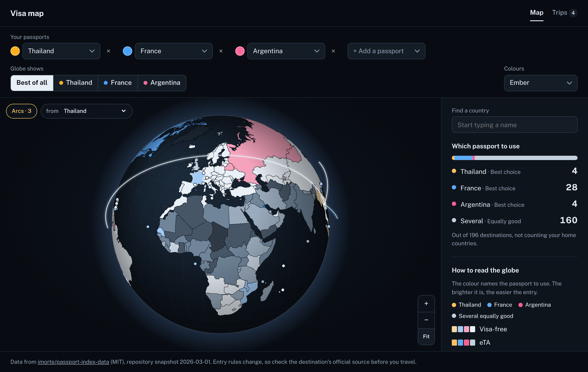

# Visa map

**Which passport should I use to travel there?**

Some people hold more than one passport. Each one gets you into different countries with different rules: walk straight in, get a visa at the airport, apply online first, or apply at an embassy weeks ahead. Visa map puts all of that on one spinning globe, so you can see at a glance which of your passports is the best choice for every country in the world.



## What it does, in plain words

1. **Pick your passports.** Add one to five. Each gets its own colour.
2. **Look at the globe.** Every country is coloured by your best passport for it. The colour tells you *which* passport, and the brightness tells you *how easy* the entry is: brighter means easier.
3. **Click a country.** You get a clear answer ("Use Germany"), plus what each passport needs there and how many days you can stay.
4. **Plan your trips.** Mark countries as *Next*, *Visited* or *Not going*. For each *Next* country the app tells you which passport to use. Turn on *Arcs* to see your upcoming trips drawn as glowing lines across the globe.

## Who it is for, and what it shows off

It is a personal tool and a portfolio project. It is small enough to read in an afternoon, and it practises things that come up in real apps:

- **Working with a public dataset** that is cleaned and checked by a script before the app uses it.
- **Turning a rule into code** ("which entry is better?") and testing it properly.
- **Drawing with d3** on a canvas: a real 3D-looking globe with drag, zoom, animation and click detection.
- **Keeping data in the browser** with `localStorage`, so there is no server, no account and no cost.
- **Careful UI details:** dark theme, colour-blind safe palette, keyboard controls, shareable links.

## Features

- Up to five passports, each country coloured by the best one (hue is the passport, brightness is how easy the entry is, grey means several are equally good)
- Four colour palettes, including a colour-blind safe one, plus a custom colour per passport
- Single-passport views with a legend that counts each entry type
- A plain-language verdict per country: "Use Germany", "Thailand or Japan", "Either works"
- Entry type and allowed stay in days for every passport you hold
- Trips tab: mark countries as Next, Visited or Not going, with the passport to use for each Next country
- Optional arcs from your home to your Next countries, coloured by the passport you would use
- Drag, scroll and pinch to move around a real globe, with keyboard controls and a Fit button
- Search for a country and the globe flies to it
- Clickable dots for tiny countries such as Monaco, Singapore and Tuvalu
- Export and import your trips as JSON
- Shareable links such as `?p=TH,DE,JP`
- Dark mode only, no account, no backend: everything is saved in your browser

## Run

```bash
# install dependencies
npm install

# run the program
npm run dev

# open in browser
http://localhost:5173
```
